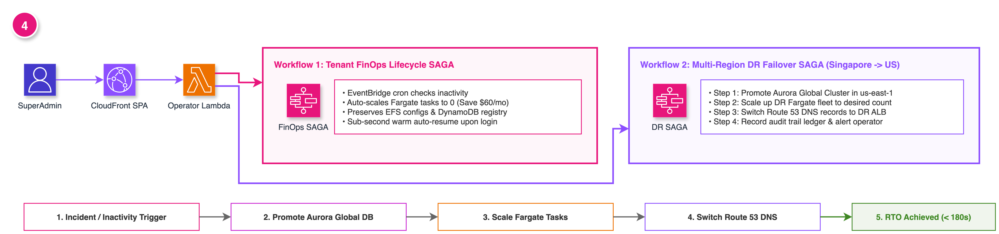

# Nextcloud SaaS Super Admin Portal

Enterprise Super Admin Web Console for multi-tenant Nextcloud on AWS, built with **React 18**, **Refine v4**, **Ant Design 5**, **TypeScript 5**, and **Vite**.

---

## Architecture Overview



The Super Admin Console provides a decoupled, secure control plane for managing multi-tenant Nextcloud fleets across AWS:

- **Edge Delivery & Security:** Amazon CloudFront CDN distribution with Origin Access Control (OAC) fronting an encrypted Amazon S3 static web bucket. Ingress protected by AWS WAF (OWASP rules, IP rate limiting, SQLi/XSS shielding).
- **Role-Based Access Control (RBAC):** Authenticated administrative roles (`SuperAdmin`, `TenantOperator`, `SecurityAuditor`) with RFC 6238 TOTP Multi-Factor Authentication.
- **Fleet Telemetry & Operational Control:** Real-time metrics visualization via Apache ECharts, live Amazon CloudWatch log streaming (`/ecs/nextcloud`), remote OCC command execution, and automated incident management.
- **Tenant Lifecycle Orchestration:** Systems Manager runbooks and dedicated container-per-tenant lifecycle provisioning.

---

## Features

- **Fleet Operations Management:** Real-time visibility into all provisioned tenants, container states, storage quotas, and dedicated AWS topology (ECS, RDS, EFS, S3, ALB).
- **In-Browser OCC Terminal & Diagnostics:** Execute Nextcloud `occ` commands (`status`, `files:scan`, `db:add-missing-indices`, `maintenance:mode`, `app:list`, `check`) with instant terminal output and exit code tracking.
- **Live Container Logs:** Stream real-time logs from Amazon CloudWatch (`/ecs/prod-nextcloud`) for both Nextcloud Apache/PHP app containers and LiteLLM Bedrock AI Bridge sidecars.
- **Incident Circuit Breaker & Accident Log:** Real-time operational incident response with automated failover and audit logging.
- **Tenant User Accounts Directory:** Super Admin password resets and user account provisioning.
- **Webhook Alerting:** Non-blocking real-time alert notifications to Slack, Discord, PagerDuty, and custom HTTP endpoints.
- **One-Click Tenant Clone ("Fork Tenant"):** Instant provisioning of isolated staging sandboxes with dedicated databases, S3 vault prefixes, and EFS access points.

---

## Getting Started

### Prerequisites

- Node.js 18+ (Node.js 20 recommended)
- npm 9+

### Installation

```bash
npm install
```

### Development Server

```bash
npm run dev
```

Starts the local development server at `http://localhost:5173`.

### Production Build

```bash
npm run build
```

Generates optimized, production-ready static assets in `dist/`.

### Automated Testing

```bash
npm test
```

Runs the automated test suite powered by Vitest, verifying RBAC access control policies, authentication & MFA lifecycle, data provider APIs, and UI components.

---

## CI/CD Deployment

Automated deployment is configured via GitHub Actions (`.github/workflows/deploy.yml`):

- Automatically triggers on every `push` to `main` branch.
- Compiles the React + Vite bundle (`npm ci && npm run build`).
- Deploys static assets to Amazon S3 (`s3://prod-nextcloud-admin-web-649519997247/`).
- Invalidates the Amazon CloudFront distribution cache (`/*`).
- Executes post-deployment smoke test verification.

---

## Architecture Diagram as Code

The console architecture diagram is generated and maintained as code using [AWS Diagram as Code (`awsdac`)](https://github.com/awslabs/diagram-as-code):

```bash
# Rebuild console architecture diagram
awsdac docs/diagrams/console_architecture.yaml -o docs/images/console_architecture.png -f
```
